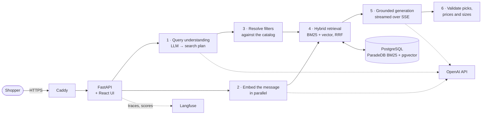

# Hybrid RAG Shopping Assistant

[](https://github.com/gokulkrisnaa-n/hybrid-rag-for-ecommerce/actions/workflows/ci.yml)

A production-shaped retrieval-augmented shopping assistant over a **25,000-product fashion catalog**. Shoppers ask in plain language and get grounded answers with product cards, comparisons and follow-up suggestions, streamed as they're written.

> *"a warm jacket under $300, not The North Face"* → an LLM turns that into a search plan (category, price cap, brand exclusion), hybrid search finds candidates, and the answer recommends real in-stock products whose prices and sizes come from the catalog, never from the model.

**Live demo:** https://18-216-165-185.sslip.io (may be paused between job-search pushes to save cost)

## Results at a glance

| | Result |
| --- | --- |
| Retrieval quality (nDCG@10, 55 labelled queries) | **0.737 → 0.814** through measured changes |
| Query understanding (structured search plans) | **36/36** test cases fully correct |
| LLM-as-judge agreement with hand labels | **100%** in-sample (32 answers), **80%** on a held-out set |
| Time to first words (p50) | **2.8 s**, down from a 4.2 s wait for the full answer |
| Cost per chat turn | **about $0.001** |
| Graceful degradation | With query understanding failing, **0 of 37** requests failed |
| Automated tests | **243** backend + **66** frontend, on every push |

## Architecture



**One turn, step by step**

1. **Query understanding.** An LLM converts the message (plus earlier turns, for follow-ups like "cheaper ones?") into a typed search plan: categories, price range, genders, brands, **brand exclusions**, sale-only, compare intent and corrected search text. Style codes skip this step and go straight to keyword search.
2. **The embedding is prefetched** while the plan is being written, so vector search rarely waits for it.
3. **Resolve.** Plan values are matched against the real catalog vocabulary. Explicit shopper filters always win over inferred ones, and inferred filters are relaxed if they leave too few results (exclusions are kept).
4. **Hybrid retrieval.** ParadeDB BM25 and pgvector HNSW run on the same Postgres, fused with Reciprocal Rank Fusion (k = 60), with fuzzy matching as a typo fallback and query-term coverage weighting.
5. **Generation.** The model writes a structured answer (kind, message, picks with reasons, comparison table, follow-up), streamed to the browser over Server-Sent Events.
6. **Validation.** Picks must come from the retrieved candidates. Prices, sale state and sizes are filled from the database, and text that states prices or stock is caught. If generation fails, the shopper still gets the top results with a fixed message.

**Deployment:** one AWS EC2 server (t4g.small, ARM) running Docker Compose: Caddy (automatic HTTPS), the app, and ParadeDB. Only Caddy is reachable from the internet. GitHub Actions deploys through AWS Systems Manager, with no inbound SSH and no stored AWS keys (details under [CI and deployment](#ci-and-deployment)).

## Evaluation

Every change to retrieval and prompts was measured before being kept. The datasets live in [`evals/`](evals) and every run's report in [`evals/results/`](evals/results).

### Retrieval: 55 labelled queries across 12 query types

| Change | nDCG@10 | MRR |
| --- | --- | --- |
| BM25 only | 0.686 | 0.781 |
| Vector only | 0.703 | 0.790 |
| **Hybrid (RRF) baseline** | **0.737** | 0.847 |
| + style codes routed to keyword search | 0.761 | 0.883 |
| + fuzzy fallback for typos | 0.767 | 0.892 |
| + query-term coverage weighting | 0.776 | 0.892 |
| + English stopwords in the BM25 index | 0.777 | 0.891 |
| + LLM query understanding, first version | 0.763 | 0.891 |
| + vector search embeds the *original* message, not the rewrite | 0.810 | 0.927 |
| **Final (query plan v6)** | **0.814** | **0.938** |

- **Hybrid beats both methods on their own.** Keyword search wins on exact names and style codes, vectors win on vague intent; fusion keeps most of both.
- **The first LLM rewrite made retrieval worse.** Rewritten text lost nuance the embedding needed. Keeping the rewrite for BM25 and filters, and embedding the shopper's own words, turned a regression into the largest single gain.
- **Most of query understanding's ranking gain is on typos (0.53 → 0.82).** It costs about 1.4 s per turn, so that's where its value is concentrated. It also enables things nDCG doesn't capture, such as "brands other than On Running" becoming a hard exclusion filter.

### Query understanding: 36 cases, field-level accuracy

Each case checks the plan's fields (categories, prices, genders, brands, exclusions, intent, out-of-scope detection) against expected values. Current prompt: **36/36 fully correct**, with every field at 100%.

### Answers: deterministic checks plus a calibrated LLM judge

- **Rule checks on 36 cases:** answer kind, valid picks, no fallback, no prices or stock in the text, excluded brands absent. Latest recorded run: 35/36.
- **LLM-as-judge:** GPT-6.1 Sol via the OpenAI Batch API scores each answer on 7 criteria (grounded, relevant, kind, comparison, conversation, safety, clarity), writing its reason before each verdict. The overall pass/fail is computed in code, not by the judge.
- **The judge was calibrated against hand labels before being trusted:**

| Judge prompt | Agreement with 32 hand labels | Cohen's κ |
| --- | --- | --- |
| v1 | 88% | 0.53 |
| v2 | 91% | 0.71 |
| v3 (frozen) | 100% | 1.00 |
| v3 on 10 held-out labels | 80% | 0.41 |

  The held-out number is the honest one: the judge is stricter than the human labeller on wording. It's used to compare versions and catch regressions, not as an absolute score.
- **Run-to-run noise is measured.** The same prompt scored 84% on one run and 72% on the next, so prompt decisions use repeated runs rather than a single score.

## Latency and cost

Measured over the 37 generation cases, streamed, with caches cleared before every turn ([`evals/run_latency.py`](evals/run_latency.py)).

| Configuration | Search p50 | First words p50 | Whole turn p50 / p95 | nDCG@10 |
| --- | --- | --- | --- | --- |
| Before (no prefetch, no streaming) | 1,839 ms | 4,229 ms (whole turn) | 4,229 / 7,180 ms | 0.806 |
| + embedding prefetch, SSE streaming | 1,654 ms | **2,844 ms** | 3,985 / 6,517 ms | 0.806 |
| + query understanding at reasoning effort `none` (current) | 1,784 ms | 2,789 ms | 4,525 / **6,395** ms | 0.814 |
| Query understanding unavailable (fallback path) | n/a | 1,175 ms | 2,600 ms | 0.777 |

- Streaming cut the perceived wait by about a third; the embedding prefetch removed the vector wait at p50 (218 ms → 0).
- Model-step timings vary by ±200–500 ms between runs, so smaller differences are noise.
- About **$0.001 per chat turn** (two model calls plus one embedding), with prompt caching on the stable parts of both prompts.

## Production engineering

- **API:** FastAPI with a single JSON error format and request IDs on every response and log line. Per-IP sliding-window rate limiting on chat, plus readiness checks that cover the database and catalog vocabulary.
- **Resilience:** OpenAI retries with full-jitter exponential backoff that honour `Retry-After`, under a shared time budget and concurrency cap. Streams retry only before the first word, and every failure path still returns a usable answer.
- **Observability:** Langfuse traces with one trace per request (trace ID = request ID). Model calls are recorded as typed generations with token usage and cost, and emails, phone numbers and card numbers are masked. Every answer is scored automatically (fallback, warnings, answer kind), and thumbs-up/down feedback is stored as a score on the same trace.
- **Frontend:** React + TypeScript (Vite) with a hand-written SSE parser for POST streams. Includes Stop, 429 auto-retry with a countdown, conversations saved in the browser, a health indicator, and a **debug panel** showing each answer's timeline, query plan, validation checks and token use, linked to its trace.
- **Delivery:** a multi-stage Docker image (the UI is built and tested inside the build) with locked Python dependencies and a non-root user, plus Compose with ParadeDB.

## CI and deployment

- **CI** ([`ci.yml`](.github/workflows/ci.yml)) runs on every push and PR: backend tests on the locked dependencies, frontend type-check, tests and build, and an ARM Docker build. No secrets are needed, because the tests fake OpenAI, Langfuse and the database.
- **Deploy** ([`deploy.yml`](.github/workflows/deploy.yml)) runs after CI passes on `main`. GitHub authenticates to AWS with a short-lived OIDC token, assumes a role that may send **one** Systems Manager command to **one** instance, and the server pulls, rebuilds, restarts and runs [`scripts/smoke_test.sh`](scripts/smoke_test.sh) against its public URL. The IAM policies and the command document are in [`deploy/aws/`](deploy/aws).
- **Evals are not in CI:** they need the real catalog and paid model calls, so they're run by hand before changing prompts or retrieval.

## Tech stack

Python 3.13 · FastAPI · PostgreSQL with ParadeDB (BM25) and pgvector (HNSW) · OpenAI (gpt-6-luna for planning and answers, text-embedding-3-small at 768 dims, gpt-6.1-sol as judge) · Langfuse · React · TypeScript · Vite · Docker · Caddy · AWS EC2 and Systems Manager · GitHub Actions · pytest · Vitest

## Repository layout

| Path | What's there |
| --- | --- |
| `app/query/` | Query understanding, filter resolution, the search entry point |
| `app/retrieval/` | BM25, vector and hybrid (RRF) search |
| `app/generation/` | Prompt, structured answer schema, streaming, validation |
| `app/chat/` | One chat turn: search → context → generate → validate |
| `app/api/` | FastAPI app, routes, SSE, rate limiting, errors |
| `app/core/` | Settings, database pool, OpenAI client, retries, tracing |
| `ingestion/` | Fetch the catalog, parse and clean it, embed it |
| `evals/` | Golden sets, eval runners, LLM judge, labelling tools, results |
| `frontend/` | The React chat UI |
| `tests/` | Backend tests |
| `db/` | Database schema |
| `deploy/`, `scripts/` | Production Compose overlay, Caddy, server setup, deploy, restore, smoke test |

## Run it yourself

**Prerequisites:** Docker, Python 3.13, Node 22, an OpenAI API key; Langfuse keys optional.

```bash
git clone https://github.com/gokulkrisnaa-n/hybrid-rag-for-ecommerce.git
cd hybrid-rag-for-ecommerce
cp .env.example .env          # fill in the Postgres settings and OPENAI_API_KEY
```

**Load the catalog**, either from a database dump:

```bash
docker compose up -d db
scripts/restore_db.sh backups/<dump-file>
```

or by building it from the source catalog (about 25,000 products to fetch and embed):

```bash
python -m venv .venv && source .venv/bin/activate
pip install -e ".[dev]"
docker compose up -d db
python -m ingestion.fetcher
python -m ingestion.parser
python -m ingestion.embedder
```

**Run everything in Docker** (UI and API on http://localhost:8000):

```bash
scripts/smoke_test.sh         # builds, starts and checks the whole stack
```

**Or develop locally** with hot reload:

```bash
python -m uvicorn app.api.main:create_app --factory --reload --port 8000
cd frontend && npm install && npm run dev      # http://localhost:5173
```

**Tests and evals:**

```bash
python -m pytest -q                            # backend
cd frontend && npm test                        # frontend
python -m evals.run_retrieval_eval --modes hybrid+qu
python -m evals.run_qu_eval
python -m evals.run_generation_eval
python -m evals.run_latency --label my-run
```

## Known limitations

- **The catalog has no activity data.** Product data carries no "running", "hiking" or "training" attributes, so a request like "running shoes" can only match product names and descriptions. This is a data gap, not a retrieval bug; fixing it means enriching the catalog, which is out of scope here.
- **Vague requests are the weakest category** (nDCG ≈ 0.57 for queries like "something warm for winter"), for the same reason.
- **Single-region, single-server deployment.** Fine for a demo, with no failover. The rate limiter and caches live in process memory, so scaling out would move them to a shared store such as Redis.
- **Evals are offline and small** (55 retrieval queries, 36 plan cases, 32 judged answers). Enough to compare versions, not to claim production-grade accuracy.
- **The judge is stricter than the human labeller** on held-out answers (80% agreement), so its scores are relative, not absolute.

## Data and disclaimer

The product data comes from Kith's public Shopify catalog endpoint and is used for a non-commercial portfolio project. This project is **not affiliated with or endorsed by Kith**. The demo UI is an independent design and states the same.